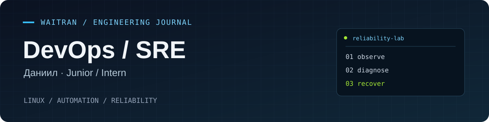
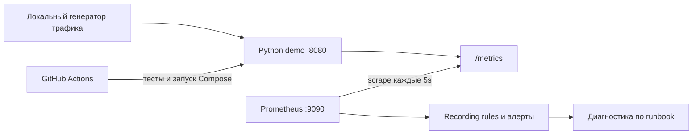

<p align="center">
  
</p>

<p align="center">
  <a href="https://github.com/waitran/sysadmin-portfolio/actions/workflows/ci.yml"></a>
  
  
</p>

# Даниил · DevOps / SRE

Развиваюсь в DevOps и инженерии надёжности. Пишу учебные инструменты на **Bash и Python**, практикую **Linux**, диагностику и автоматизацию. Фокус портфолио — **Junior / стажировка**.

Здесь можно посмотреть код, запустить небольшой сервис, создать контролируемый сбой и пройти его диагностику по runbook. Все проекты ниже — учебные.

[Запустить стенд](#быстрый-запуск) · [Разобрать сбой](docs/RUNBOOK.md) · [SLO и метрики](docs/SLO.md) · [План развития](docs/ROADMAP.md) · [GitHub-профиль](https://github.com/waitran)

## Проекты

### 01 / Reliability Lab

**Python · Docker Compose · Prometheus · GitHub Actions**

Небольшой HTTP-сервис с метриками запросов, ошибок и длительности операций. В стенде есть проверки здоровья, правила алертов, тесты и сценарии ошибок/задержек. Запуск локальный; облачный аккаунт не нужен.

| Что проверить | Где смотреть |
| --- | --- |
| HTTP-сервис, проверка параметров, счётчики и histogram | [app/](app/), [tests/](tests/) |
| Сборка контейнера и запуск без root | [Dockerfile](Dockerfile), [compose.yaml](compose.yaml) |
| Сбор метрик, recording rules, алерты и их тесты | [monitoring/](monitoring/) |
| Автоматические проверки при push и pull request | [GitHub Actions](.github/workflows/ci.yml) |
| Определение SLI, SLO и бюджета ошибок | [SLO.md](docs/SLO.md) |
| Диагностика → восстановление → подтверждение | [RUNBOOK.md](docs/RUNBOOK.md) |
| Структура разбора инцидента для заполнения после практики | [INCIDENT-TEMPLATE.md](docs/INCIDENT-TEMPLATE.md) |
| Результаты автоматической проверки стенда | [VALIDATION.md](docs/VALIDATION.md) |



Алерты отображаются в интерфейсе Prometheus. Отправка уведомлений и Alertmanager — отдельный следующий этап.

### 02 / Linux & Automation Diary

**Linux · Bash · Python · Git**

Мой [DevSecOps-Diary](https://github.com/waitran/DevSecOps-Diary) — дневник лабораторных и небольших CLI-инструментов:

| Пример | Что есть в репозитории |
| --- | --- |
| [Архивирование и резервные копии](https://github.com/waitran/DevSecOps-Diary/blob/main/day-007/backup_tool.sh) | Bash, аргументы CLI, tar/gzip, журналирование |
| [Мониторинг GitHub-репозитория](https://github.com/waitran/DevSecOps-Diary/blob/main/day-006/repo_monitor.sh) | curl, jq, HTTP-коды и обработка ответа API |
| [Разбор SSH-логов](https://github.com/waitran/DevSecOps-Diary/blob/main/day-008/log_parser.py) | Python, регулярные выражения, агрегация IP, JSON |
| [SSH и systemd](https://github.com/waitran/DevSecOps-Diary/blob/main/day-004/notes.md) | Заметки о сервисах, конфигурации и диагностике |
| [Git workflow](https://github.com/waitran/DevSecOps-Diary/blob/main/day-005/notes.md) | Ветки, pull request, ревью и merge |

В дневнике также сохранены заметки и промежуточные версии упражнений.

## Быстрый запуск

Нужны Git, Docker Engine с Compose v2+ и `make`. Для локальных тестов и генератора трафика — Python 3.12+. Python-библиотеки устанавливать не требуется. Порты 8080 и 9090 должны быть свободны.

```bash
git clone https://github.com/waitran/sysadmin-portfolio.git
cd sysadmin-portfolio
make test
make up
make smoke
make load
```

Откройте [сервис](http://127.0.0.1:8080/healthz), [метрики](http://127.0.0.1:8080/metrics), [targets](http://127.0.0.1:9090/targets) и [алерты](http://127.0.0.1:9090/alerts). После двух успешных сборов метрик можно выполнить запрос `demo:requests:rate5m` в Prometheus.

```bash
make chaos       # 3 минуты трафика, 25% ответов — учебные ошибки HTTP 500
make recover     # 5,5 минуты успешного трафика; старые ошибки уйдут из окна 5m
make latency     # отдельный сценарий: ответы с задержкой 600 ms
make down        # остановка стенда; история Prometheus сохраняется в volume
```

Сценарии можно остановить через `Ctrl+C`. Инъекции включены явно через `ENABLE_FAULT_INJECTION=true` в Compose. Сервис и Prometheus опубликованы только на `127.0.0.1`; стенд предназначен для локальной практики. При запуске сервиса напрямую инъекции по умолчанию выключены.

## Как оценить проект

1. Запустить `make test`, `make check-config`, `make test-rules` и `make smoke`.
2. Убедиться, что target `demo` имеет состояние **UP**.
3. Вызвать учебные ошибки через `make chaos` и сопоставить счётчики, отношение ошибок и состояние алерта.
4. Пройти [runbook](docs/RUNBOOK.md), восстановить успешный трафик и дождаться выхода ошибок из окна наблюдения.
5. Заполнить [шаблон инцидента](docs/INCIDENT-TEMPLATE.md) своими наблюдениями и замерами.

99,5% успешных операций за 30 дней — **учебная целевая SLO**, а не измеренная доступность этого проекта. Метрика охватывает завершённые валидные операции `/api/work`; сетевые ошибки и полная недоступность требуют отдельных сигналов. Подробнее о границах измерения — в [SLO.md](docs/SLO.md).

## Дальше

Ближайшие шаги: synthetic checks, маршрутизация уведомлений, дашборд, развёртывание в Kubernetes и инфраструктура как код. Статус и критерии готовности — в [ROADMAP.md](docs/ROADMAP.md).

Для связи и просмотра остальных работ: [@waitran на GitHub](https://github.com/waitran).
